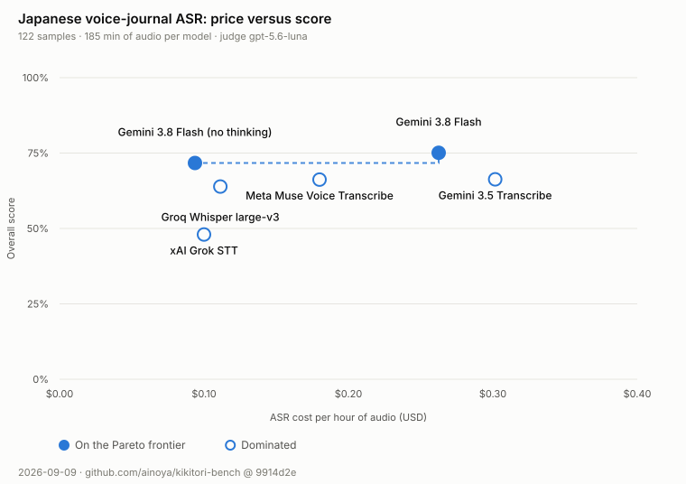
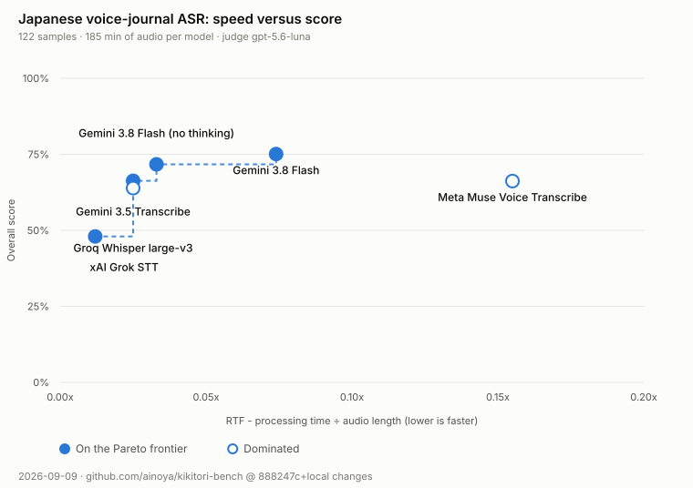
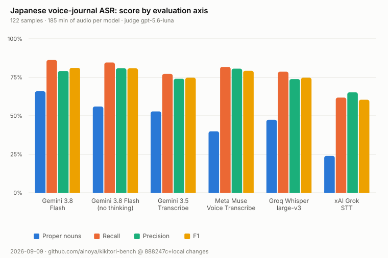

# kikitori-bench

A private benchmark for **Japanese** speech-to-text, scored by an LLM-as-a-judge against
per-claim checklists instead of Word Error Rate.

## Why this exists

I built this to choose the transcription engine for [Ayumi](https://ayumi.femto-cloud.com/capture/),
my voice-journaling app. Picking an engine meant comparing candidates on the audio Ayumi
actually receives - unscripted Japanese dictation, recorded on a phone, full of names,
numbers and half-finished sentences, mostly a single speaker but with the occasional
passage of conversation - and the standard metrics could not tell me what I needed to know.

**WER and CER do not work well for Japanese.** There are no word boundaries, so word error
rate mostly measures the tokenizer. Character error rate is dominated by orthographic noise:
kanji vs kana, okurigana, punctuation the model may or may not emit. Both charge only a
few characters when a common idiom is transcribed as a string of similar-sounding
syllables that is not Japanese at all - the same price as a harmless spelling variant,
even though one destroys the sentence and the other does not. When I read the
transcripts by hand, the ranking I formed had almost nothing to do with what CER said.

So the benchmark measures what I actually care about when I read back a journal entry:

- **Did it keep the propositions I stated?** (recall) and **did it assert things I never
  said?** (precision) - judged claim by claim, so a single slip in a 90-second recording
  does not collapse the whole sample to zero.
- **Did it get names and numbers right?** - scored deterministically, because a name
  transcribed as a different name is wrong even when the sentence reads perfectly.

Neither WER nor CER is computed at all. Catastrophic output is caught structurally instead:
an empty transcript scores zero and is counted separately in the report, and a request the
provider rejects is recorded as an error rather than silently scored as a bad transcript.

## Dataset

The corpus this was developed against is **private and stays private**, so it is not
part of this repository and the results below are not independently reproducible.
Audio, transcripts, run artefacts and reports are all git-ignored; only the synthetic
`demo` dataset is committed, as a template for the file format. Point the tooling at
your own recordings and it works the same way.

## Results (September 2026)

122 samples, 3h 05m of Japanese speech per model, every sample under 10 minutes so that
every provider sees the same set. Judged by `gpt-5.6-luna`. Overall = proper-noun F1 x 0.30
+ proposition F1 x 0.70. Full tables, confidence intervals and pairwise tests:
**[docs/results.md](docs/results.md)**.

| # | Model | Overall | 95% CI | Proper nouns | Recall | Precision | RTF | ASR cost / audio hour |
| :--- | :--- | :---: | :---: | :---: | :---: | :---: | :---: | :---: |
| 1 | Gemini 3.8 Flash | **75.1%** | [70.6, 79.5] | 65.9% | 86.2% | 79.1% | 0.07x | $0.263 |
| 2 | Gemini 3.8 Flash (thinking off) | 71.7% | [66.6, 76.6] | 56.0% | 84.6% | 80.8% | 0.03x | **$0.094** |
| 3 | Gemini 3.5 Transcribe | 66.3% | [61.6, 71.0] | 52.8% | 77.2% | 74.0% | 0.03x | $0.302 |
| 4 | Meta Muse Voice Transcribe | 66.2% | [62.3, 70.1] | 39.9% | 81.7% | 80.6% | 0.15x | $0.180 |
| 5 | Groq Whisper large-v3 | 63.9% | [59.5, 68.1] | 47.4% | 78.6% | 73.8% | 0.03x | $0.111 |
| 6 | xAI Grok STT | 48.0% | [43.3, 52.6] | 23.9% | 61.8% | 65.2% | 0.01x | $0.100 |







What the numbers said, for my use case:

- **Gemini 3.8 Flash leads**, and the gap to everything except its own thinking-off variant
  survives a Bonferroni correction over all 15 pairs.
- **Thinking is not worth its price here.** Turning it off costs 3.4pp (95% CI [-0.4, +7.1],
  i.e. not distinguishable) and saves 64% of the spend and half the latency. It does help on
  proper nouns (65.9% vs 56.0%) and slightly hurts precision, so the two effects cancel.
- **Meta Muse rejects audio longer than 10 minutes.** Those samples are excluded here to keep
  the comparison fair; it is still a hard constraint in production.
- Every model ran with identical request parameters, all recorded in the run manifest.

Regenerate this summary and the charts from a finished run with:

```bash
pnpm kikitori publish <run_id>
```

It reads only aggregate fields - leaderboard, statistics, token counts, costs - so no
sample id or transcript can reach the published output.

## Disclaimer

**The dataset cannot be published.** The corpus is private, so only the aggregate results
above are shared. That means these numbers are **not independently reproducible**: you can
run the same tooling, but not on the same audio.

Please treat the table as one person's evidence for one decision, not as a vendor-neutral
leaderboard, and **use the numbers at your own risk**:

- **Mostly one speaker, one language, one recording setup.** The corpus is predominantly
  single-speaker dictation with a few conversational passages, so the scores reflect one
  voice, one vocabulary and one microphone. Nothing here measures how these engines handle
  meetings, multi-party audio or speaker attribution. Your audio will rank differently.
- **The judge is an LLM.** Measured self-consistency was Cohen's kappa 0.81 on re-judged
  samples, and agreement with a human reviewer was kappa 0.84 over a 30-item audit - good,
  but not an oracle. Differences smaller than a few points are noise.
- **Prices are list prices at the time of the run** (September 2026) and are recomputed from a
  price list in `kikitori.config.yaml`; they go stale.
- **Model versions move.** A result here describes a model on a given day, nothing more.

No warranty of any kind. If a decision matters to you, run the benchmark on your own audio.

---

## Features

- **Fully private.** Audio and transcripts stay in your local environment; `.gitignore` and
  `pnpm check:leaks` keep them out of commits.
- **Claim-level evaluation with an LLM-as-a-judge** (Codex App Server / GPT-5.6 Luna). The
  judge rules on each `key_point` individually - **present**, **missing** or **contradicted**,
  with a critical/minor severity - and lists assertions the hypothesis makes that the ground
  truth does not support. Those become **proposition recall** (did it keep what was said) and
  **proposition precision** (did it invent anything), combined with F-beta; `scoring.fBeta`
  decides whether an omission or a fabrication weighs more (default: equal). Judging per claim
  rather than per clip keeps the score resolving on long recordings, where a single slip would
  otherwise fail the whole sample. Every verdict is stored with its rationale and evidence.
- **Deterministic proper-noun scoring.** Names, numbers and coined words are extracted from the
  reference and the hypothesis with the same local morphological analyser (kuromoji, no API)
  and compared as sets, giving recall, precision and F1. A name transcribed as a different name
  is wrong even when the sentence reads perfectly, so this axis never goes through the LLM.
- **Ground truth drafting and key-point refinement with Gemini.** Draft transcripts from audio,
  then re-derive `key_points` from a verified transcript at a granularity computed from the
  audio length (`kikitori dataset refine`).
- **Human-in-the-loop review web UI.** Listen to audio (speed control, seeking), edit ground
  truth, adjust key points, and verify samples with one-key shortcuts. English and Japanese.
- **Recorded experiment conditions.** Every run stores the resolved request parameters of each
  model - prompt, language, temperature, thinking budget, response format, diarization mode,
  biasing, audio preprocessing - plus judge settings and scoring weights. Unset values are
  recorded as `provider default`, so a report always states the condition it was produced under.
- **Token usage and cost accounting.** Per-request consumption for both the ASR call and the
  judge turn, converted to USD from the price list in `kikitori.config.yaml`, covering
  token-billed and audio-duration-billed providers alike. Costs are recomputed from stored
  usage on every report, so editing prices re-prices past runs.
- **Statistical reliability.** Bootstrap confidence intervals, all pairwise comparisons with a
  multiple-comparison adjustment, exact McNemar tests per axis, latency percentiles, and an
  item analysis showing which samples actually discriminate between models.
- **Pluggable ASR adapters.** xAI Grok STT, Gemini 3.8 Flash, Gemini 3.5 Transcribe, Meta Muse
  Voice Transcribe, Groq-hosted Whisper, OpenAI Whisper, plus generic HTTP endpoints and local
  CLI commands.

---

## Prerequisites & Setup

### Tooling
This project requires **mise** (Node v26) and **pnpm**.
`ffmpeg` must also be on `PATH` for the Meta Muse adapter, which only accepts mono 16 kHz 16-bit PCM WAV input (other formats are transcoded on the fly).

```bash
# Trust project configuration
mise trust

# Install tools (Node v26, pnpm)
mise install

# Install dependencies
pnpm install

# Run strict type checking
pnpm typecheck
```

### Environment variables
Copy `.env.example` to `.env` and configure your API keys:

```bash
cp .env.example .env
```

Configuration items in `.env`:
```ini
# xAI API Key for Grok Speech-to-Text
XAI_API_KEY=your_xai_api_key

# Gemini API Key (for drafting and Gemini ASR)
GEMINI_API_KEY=your_gemini_api_key

# Groq API Key (for Groq-hosted Whisper large-v3)
GROQ_API_KEY=your_groq_api_key

# Meta API Key (for Muse Voice Transcribe)
META_API_KEY=your_meta_api_key

# OpenAI API Key (for Whisper ASR)
OPENAI_API_KEY=your_openai_api_key

# Codex App Server (for the GPT-5.6 Luna judge)
CODEX_APP_SERVER_URL=ws://127.0.0.1:4500
CODEX_APP_SERVER_MODEL=gpt-5.6-luna

# Obsidian vault directory for 'dataset import-journal' (personal path, never committed)
JOURNAL_VAULT_DIR=/path/to/your/vault/journal/2026

# Local Review Web UI port
REVIEW_PORT=3000
```

---

## Benchmark Workflow

### Initialize a dataset and add audio
```bash
# Create a new dataset
pnpm kikitori dataset init my_dataset_ja -d "Internal Audio Benchmark"
```
Place your private audio files (`.wav`, `.mp3`, `.m4a`, etc.) into `datasets/my_dataset_ja/audio/`.

```bash
# Scan audio directory and register files in dataset.yaml
pnpm kikitori dataset scan my_dataset_ja
```

---

### Draft ground truth with Gemini (optional)
Generate draft transcripts and key points from the audio, as a starting point for review.
(The drafter also proposes `expected_terms`; they are kept for reference only - proper nouns
are scored by the deterministic extractor, not from that list.)

```bash
pnpm kikitori dataset draft my_dataset_ja --concurrency 2
```

---

### Refine the key points

The score resolves per claim, so the granularity of `key_points` sets the resolution of the
benchmark. This re-derives them from the verified transcript, with a target count computed
from each recording's length:

```bash
pnpm kikitori dataset refine my_dataset_ja
```

---

### Review and verify in the web UI
Listen to audio in your browser, review/edit transcripts and terms, and mark samples as verified:

```bash
pnpm kikitori review my_dataset_ja
# Opens http://localhost:3000?dataset=my_dataset_ja
# Shortcut: Cmd + Enter (Ctrl + Enter) to approve and proceed to the next item
```

---

### Run the ASR models
Execute transcription across verified samples using your chosen ASR models:

```bash
# Run specific models (e.g., xAI Grok, Gemini, Meta Muse, Groq Whisper)
pnpm kikitori run my_dataset_ja -m xai-grok gemini-flash gemini-transcribe meta-muse groq-whisper

# Offline / dry-run test using mock model
pnpm kikitori run my_dataset_ja -m mock --all
```
Results are saved to `runs/<run_id>/asr_results.json`.

---

### Evaluate with the judge
With Codex App Server running, evaluate the ASR hypotheses against the Ground Truth:

```bash
# Start Codex App Server in another terminal
codex app-server --listen ws://127.0.0.1:4500

# Run evaluation
pnpm kikitori eval my_dataset_ja --run run_2026-09-07T07-04-39-940Z

# (For offline testing with mock judge)
pnpm kikitori eval my_dataset_ja --run <run_id> --mock-judge
```

---

### Or run the whole pipeline at once
Execute the entire pipeline (ASR execution -> judge evaluation -> Leaderboard generation) in a single step:

```bash
pnpm kikitori benchmark my_dataset_ja -m xai-grok gemini-flash gemini-transcribe meta-muse groq-whisper
```

---

## Output

A formatted leaderboard is printed directly to the terminal, and a comprehensive markdown report with evidence citations is generated under `reports/<run_id>.md`.

### Terminal leaderboard
```
=====================================================================================
  KIKITORI-BENCH LEADERBOARD
  Dataset: my_dataset_ja | Judge: gpt-5.6-luna | Run: run_2026-09-08T02-40-45-884Z
=====================================================================================
Rank  | Model                |   Overall |     Names |     Recall |  Precision |       F1
-------------------------------------------------------------------------------------
#1    | Gemini 3.8 Flash     |     75.1% |     65.9% |      86.2% |      79.1% |    81.1%
#2    | Gemini 3.8 Flash (no |     71.7% |     56.0% |      84.6% |      80.8% |    80.8%
#3    | Gemini 3.5 Transcrib |     66.3% |     52.8% |      77.2% |      74.0% |    74.7%
=====================================================================================
```

### Report contents
- **Aggregate Leaderboard**: Weighted overall score, per-axis breakdown, average latency, total cost.
- **Reliability**: Bootstrap confidence intervals, every pairwise comparison (Bonferroni-adjusted) with an exact McNemar test on the
  check-backed axes, latency percentiles, and an item analysis showing which samples actually discriminate between models.
- **Experiment Conditions**: Judge model / endpoint / temperature, scoring weights, sample count, and the resolved request parameters of every model.
- **Token Usage & Cost**: Per-model audio length, ASR input tokens (audio/text), ASR output tokens, ASR cost, judge input tokens (cached), judge output tokens (reasoning), judge cost, and the run total. `~` marks a cost estimated from audio length when the provider reports no token counts.
- **Per-Sample Detailed Evaluations**:
  - Ground Truth text
  - Model hypothesis
  - Itemized checks (PASS / FAIL badge, rationale, quoted excerpt evidence).

---

## Configuration (`kikitori.config.yaml`)

- **Weights (`weights`)**: `proper_noun_f1` and `proposition_quality`, summing to 1.0. The overall score is not a plain weighted mean - recall and precision are combined with F-beta first, so a model cannot score well by transcribing almost nothing.
- **Scoring (`scoring.fBeta`)**: 1.0 treats an omission and a fabrication as equally bad; below 1 weights precision, above 1 weights recall.
- **Options (`options`)**: Per-model request parameters, recorded as the experiment condition of every run. Unset values keep the provider default:
  - `prompt`: transcription instruction / vocabulary biasing hint (Gemini, Whisper, Groq, xAI).
  - `language`: language hint such as `ja` (Whisper, Groq, xAI).
  - `temperature`, `maxOutputTokens`: decoding controls.
  - `thinkingBudget` / `thinkingLevel`: Gemini thinking controls, both nested under
    `generationConfig.thinkingConfig`. `thinkingBudget: 0` disables thinking, which cuts output
    tokens and cost sharply. A top-level `thinkingLevel` is rejected by the API.
  - `responseFormat`: `json` / `verbose_json` / `text` (Whisper, Groq).
  - `mode`, `audioEncoding`, `languageBias`, `keywords`: Meta Muse Voice Transcribe settings.
- **Pricing (`pricing`)**: Optional per-model price list, also available under `judge` for the LLM-as-a-judge model. All rates are USD:
  - `inputPerMTok` / `cachedInputPerMTok` / `audioInputPerMTok` / `outputPerMTok`: per 1M tokens (token-billed models).
  - `perAudioHour` / `minBillableSeconds`: per hour of audio, with an optional minimum billed length per request (duration-billed STT APIs).
  - `estimateAudioTokensPerSecond` / `estimateOutputTokensPerMinute`: fallback ratios used to estimate cost when the provider omits token counts.
  - A model without a `pricing` block simply reports `-` instead of a cost.
- **Models (`models`)**:
  - `xai`: xAI Grok STT endpoint
  - `gemini`: Gemini ASR (`gemini-3.8-flash`, `gemini-3.5-transcribe`, ...)
  - `meta`: Meta Muse Voice Transcribe (`https://api.meta.ai/v1/asr/transcribe`, requires `ffmpeg`)
  - `groq`: Groq-hosted Whisper (OpenAI-compatible `/audio/transcriptions`)
  - `whisper`: OpenAI Whisper ASR
  - `custom-http`: Custom REST API endpoint
  - `custom-command`: Local command template (e.g. `whisper {audio_path}`)

---

## Commands

| Command | What it does |
| :--- | :--- |
| `dataset init <name>` | Create a dataset directory and manifest |
| `dataset scan <name>` | Register new audio files found in `datasets/<name>/audio/` |
| `dataset import-journal [dir]` | Import audio and transcripts from an Obsidian vault (`JOURNAL_VAULT_DIR`) |
| `dataset draft <name>` | Draft transcripts, terms and key points from audio with Gemini |
| `dataset refine <name>` | Re-derive `key_points` from verified transcripts at a length-aware granularity |
| `review <name>` | Local web UI for listening, editing and verifying |
| `run <name>` | Run the ASR models and store hypotheses |
| `eval <name> --run <id>` | Judge a finished run; re-running retries only what is missing |
| `benchmark <name>` | `run` followed by `eval` |
| `repair <run>` | Retry the ASR requests that failed in a run and drop their stale judgements |
| `report <run>` | Regenerate the full local report, recomputing costs from the current price list |
| `rescore <run>` | Re-apply the current scoring formula and weights without calling the judge |
| `publish <run>` | Write the aggregate-only summary and standalone SVG charts to `docs/` |
| `judge-consistency <run>` | Re-judge a subsample to measure how much the judge disagrees with itself |
| `judge-audit <run>` | Export a worksheet of individual checks for human labelling, or score a filled one |

Common flags: `-m` selects models, `-l` limits the number of samples, `-d` skips samples
longer than N seconds, `-c` sets concurrency, `--lang en|ja` picks the report language.

---

## Development & Testing

```bash
# Check that nothing private is staged for commit: audio, transcripts, run
# artefacts, personal paths, API keys, or a phrase copied from the recordings
# into a comment or an example.
pnpm check:leaks

# Type check (strict TypeScript + Effect)
pnpm typecheck

# Build distribution bundle
pnpm build

# Run CLI help
pnpm kikitori --help
```
